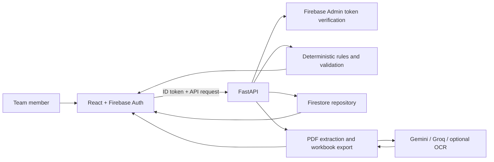

# ObliGOT

### Partnership operations, obligations, and document intelligence

ObliGOT is a partnership management platform created for the **Tata STRIVE Code Odyssey 5.0 hackathon**. It brings partner relationships, opportunities, agreements, programmes, financial records, and reporting obligations into one workspace—then highlights what needs attention, why it matters, and what to do next.

> **Project status:** Hackathon prototype. Validate configuration, data, authorization, and operational workflows before using it for production or real partner commitments.

<p align="center">
  
  
  
  
  
  
  
  
  
</p>

## What ObliGOT does

Partnership teams often track MOUs, opportunities, programme delivery, invoices, reports, and follow-ups in separate spreadsheets. ObliGOT provides a shared operational view and a document workflow that turns agreements into evidence-linked, editable spreadsheet output.

The system is designed around a clear division of responsibility:

- **Deterministic code** evaluates dates, deadlines, statuses, alert priorities, and arithmetic.
- **AI** assists with document reading and contextual recommendations; its output is advisory and may fail.
- **People** review the evidence, decide how to respond to alerts, and manage operational records.

## Core capabilities

### Operational workspace

- **Dashboard:** portfolio summary and the highest-priority active alerts.
- **Action Center:** alert evidence, reasons, recommended next steps, and human review actions.
- **Partners and Pipeline:** partner records, opportunities, ownership, stages, and next steps.
- **Agreements and Projects:** agreement lifecycle and programme delivery records.
- **Reports & UCs:** reporting obligations and utilization-certificate tracking.
- **Import:** preview, validate, and explicitly confirm supported CSV/XLSX imports.

The API and data model also support finance records. There is currently **no standalone Finance page** in the frontend.

### Explainable alerts

Alerts are computed from current records rather than stored as fixed snapshots. Each alert includes evidence, why it matters, a recommended action, and a transparent priority breakdown. Examples include agreements approaching expiry, missing signed copies, overdue reports or milestones, and opportunities needing follow-up.

Alert IDs are stable for the same rule and record. Human decisions—such as acknowledging, deferring, dismissing, or creating a task—are persisted; updating the underlying record can cause the alert to be reevaluated. Business dates use **Asia/Kolkata**.

### MOU and addendum workbooks

1. Upload an MOU or addendum PDF.
2. PyMuPDF reads embedded text and renders pages when needed. Scanned pages can be read with configured AI vision or optional local OCR.
3. The extraction workflow proposes fields, clauses, obligations, financial terms, programme scope, and tables with source-page evidence.
4. Deterministic validation checks values and evidence against the supplied document text or page reading.
5. Download an editable, document-scoped Excel workbook containing extracted values and their supporting evidence.

Extraction is advisory: it does **not** automatically create or update operational records. Workbook edits are not synchronized back into ObliGOT. Addendum comparisons remain document-scoped rather than silently changing an agreement.

### AI recommendations

The alert recommendation endpoint uses Gemini when configured. Document reading and structured extraction use the configured provider path, with Gemini and Groq support; local OCR can provide an additional reading fallback when installed and enabled. Provider failures are surfaced, and deterministic alerts remain available without AI. No AI output should be treated as verified operational data without human review.

## Technology

| Layer               | Technologies                                                                               |
| ------------------- | ------------------------------------------------------------------------------------------ |
| Frontend            | React 18, TypeScript, Vite, React Router, Lucide, CSS                                      |
| Backend API         | Python, FastAPI, Pydantic                                                                  |
| Data                | Cloud Firestore through the Firebase Admin SDK                                             |
| Authentication      | Firebase Authentication in the browser; optional Firebase ID-token verification in FastAPI |
| Document processing | PyMuPDF, openpyxl, Gemini, Groq; optional RapidOCR/Tesseract                               |
| Testing             | pytest, TypeScript compiler, Vite production build                                         |

## Architecture



- FastAPI is the only application backend; API routes are mounted under `/api`.
- The browser uses Firebase Authentication and calls FastAPI. It does not access Firestore directly.
- Firestore client rules deny direct browser reads and writes. Backend authorization is enforced by the API when `REQUIRE_FIREBASE_AUTH=true`.
- AI keys and Firebase Admin credentials belong in the backend environment or a secret manager—never in frontend variables or source control.

## Run locally

### Prerequisites

- Python 3.12 recommended
- Node.js and npm
- A Firebase project with Authentication and Cloud Firestore enabled for live use
- Gemini and/or Groq credentials for AI-powered workflows
- Optional: RapidOCR or Tesseract for local OCR

### Windows PowerShell: first-time setup

Open a terminal at the repository root. The backend virtual environment belongs in `backend\.venv`; do not use a root-level `.\.venv` for this project.

```powershell
Set-Location .\backend
py -3.12 --version
if (-not (Test-Path .\.venv\Scripts\python.exe)) { py -3.12 -m venv .venv }
if (-not (Test-Path .env)) { Copy-Item .env.example .env }
.\.venv\Scripts\python.exe -m pip install -r requirements.txt
```

In a second terminal, also starting from the repository root:

```powershell
Set-Location .\frontend
if (-not (Test-Path .env)) { Copy-Item .env.example .env }
npm install
```

Fill in the local environment files as described in [Firebase and environment configuration](#firebase-and-environment-configuration). Do not replace an existing `.env` if it already contains your local configuration.

### Start the app

Use **two terminals**. The working directories matter: Uvicorn must start in `backend/` so Python can import `app` and the backend loads `backend/.env`.

**Terminal 1 — backend**, from the repository root. Activate the existing backend virtual environment in PowerShell:

```powershell
Set-Location .\backend
.\.venv\Scripts\Activate.ps1
python --version
python -m uvicorn app.main:app --reload --host 127.0.0.1 --port 8000
```

After activation, PowerShell should show `(.venv)` at the start of the prompt. If script execution is blocked, allow activation for this terminal session only, then activate:

```powershell
Set-ExecutionPolicy -Scope Process -ExecutionPolicy RemoteSigned
.\.venv\Scripts\Activate.ps1
```

**Terminal 2 — frontend**, from the repository root:

```powershell
Set-Location .\frontend
npm run dev -- --host 127.0.0.1
```

Open `http://127.0.0.1:5173`. The API is at `http://127.0.0.1:8000`; interactive documentation is at `/docs`, and its health endpoint is `/api/health`. Sign in with a Firebase user when the local web-app configuration is present.

On macOS or Linux, activate the existing backend environment from `backend/` with `source .venv/bin/activate`, then run `python -m uvicorn app.main:app --reload --host 127.0.0.1 --port 8000`. Start Vite from `frontend/` with `npm run dev -- --host 127.0.0.1`.

### Troubleshooting startup

- **`ModuleNotFoundError: No module named 'app'`:** the command was run from the repository root, or used the wrong virtual environment. Run `Set-Location .\backend`, activate with `.\.venv\Scripts\Activate.ps1`, and launch Uvicorn from that directory. The backend package is `backend\app`, not a root-level `app`.
- **Wrong Python version:** check `.\.venv\Scripts\python.exe --version` from `backend/`. Recreate `backend\.venv` with `py -3.12 -m venv .venv` if it was created with an incompatible interpreter. Do not delete or recreate an environment that contains work you need; use a new environment path if unsure.
- **Port 8000 or 5173 is already in use:** check whether the backend or Vite is already running in another terminal and use that instance instead of starting a duplicate. Stop only the server process you own with Ctrl+C in its terminal.
- **Frontend cannot reach the API:** confirm the backend is running at the URL in `frontend/.env` (`VITE_API_BASE_URL`) and restart Vite after editing frontend environment settings.
- **Sign-in/API token errors:** frontend Firebase web-app settings and backend Firebase project/credentials must refer to the same Firebase project. Restart the corresponding server after changing its `.env`, then sign out and sign back in.

## Checks

Run the backend tests:

```powershell
Set-Location backend
.\.venv\Scripts\python.exe -m pytest -q .\tests
```

Build and type-check the frontend:

```powershell
Set-Location frontend
npm run build
```

## API and project references

- API overview: [`docs/API_ENDPOINTS.md`](docs/API_ENDPOINTS.md)
- Workbook schema: [`docs/WORKBOOK_SCHEMA.md`](docs/WORKBOOK_SCHEMA.md)
- Backend API docs while running: `http://127.0.0.1:8000/docs`
